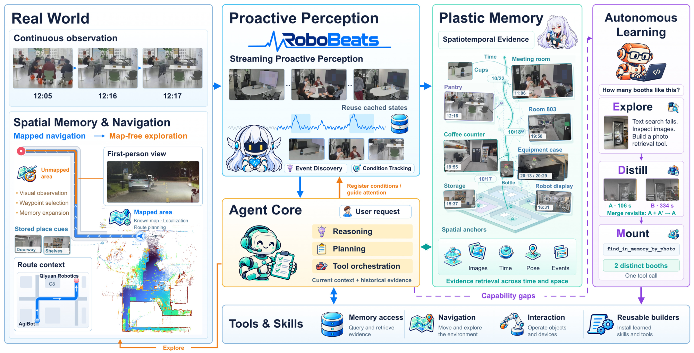
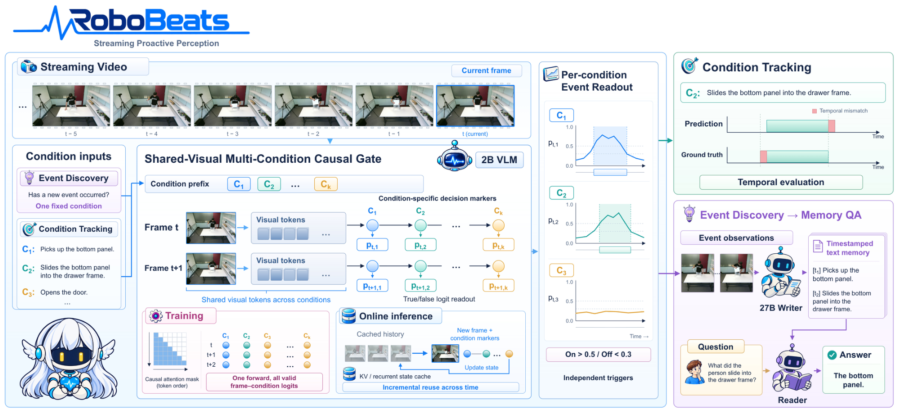
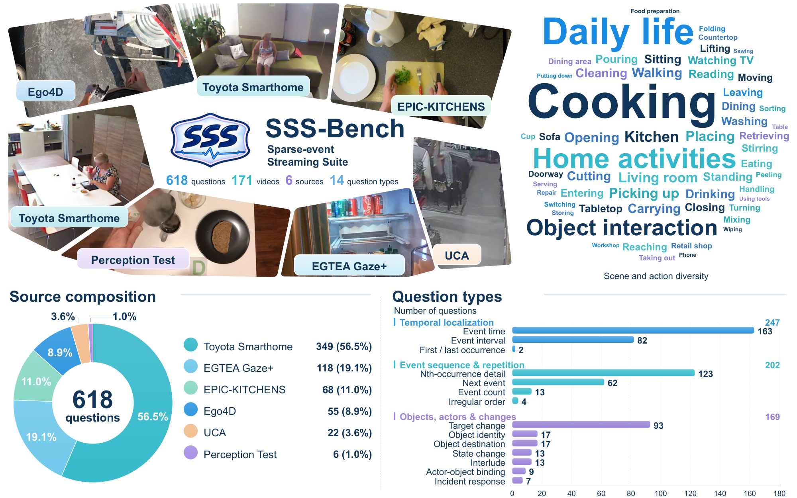

<div align="center">


<p>
  <a href="https://arxiv.org/abs/2611.00180"><b>📄 arXiv</b></a> |
  <a href="#-robobeats"><b>🎵 RoboBeats</b></a> |
  <a href="#models"><b>🤗 Models</b></a> |
  <a href="#-sss-bench"><b>📊 SSS-Bench</b></a> |
  <a href="#-citation"><b>📝 Citation</b></a>
</p>

</div>

## 🔥 News

- **[2026-11-03]** 🎉 Released RoboBeats: inference code and model weights ([0.8B](https://huggingface.co/superbigsaw/RoboBeats-0.8B), [2B](https://huggingface.co/superbigsaw/RoboBeats-2B), [4B](https://huggingface.co/superbigsaw/RoboBeats-4B)). Released SSS-Bench: the benchmark, evaluator and reproduction scripts.
- **[2026-10-30]** 📄 The [paper](https://arxiv.org/abs/2611.00180) is on arXiv.

## ✨ Introduction



LIFE (Lifelong Intelligence from Experience) is a framework for robots that keep observing, remember selectively, and turn experience into new capabilities.

## 🎵 RoboBeats



RoboBeats is a small, strictly causal VLM gate. It watches a 1 fps video stream and scores every frame. In event discovery mode, the score is the probability that a new event has just occurred. Only the frames around detected events are written into memory.

### Models

| Model | Base model |
|---|---|
| [🤗 RoboBeats-0.8B](https://huggingface.co/superbigsaw/RoboBeats-0.8B) | Qwen3.5-0.8B |
| [🤗 RoboBeats-2B](https://huggingface.co/superbigsaw/RoboBeats-2B) | Qwen3.5-2B |
| [🤗 RoboBeats-4B](https://huggingface.co/superbigsaw/RoboBeats-4B) | Qwen3.5-4B |

Each model is a LoRA adapter; the base model is downloaded automatically.

### Installation

```bash
git clone https://github.com/AgibotTech/LIFE.git && cd LIFE
pip install -r requirements.txt
```

The default `torch==2.13.0` wheel is built for CUDA 13 and needs NVIDIA driver ≥ 580. With a CUDA 12.x driver, switch to the CUDA 12.9 builds:

```bash
pip install --force-reinstall torch==2.13.0 --index-url https://download.pytorch.org/whl/cu129
pip install --force-reinstall --no-deps torchvision==0.28.0 torchaudio==2.11.0 --index-url https://download.pytorch.org/whl/cu129
```

### Quick Start

```bash
python -m robobeats my_video.mp4 --gate-model superbigsaw/RoboBeats-2B --out probs.json
```

Models, Python API and the readout: [robobeats/README.md](robobeats/README.md).

## 📊 SSS-Bench



SSS-Bench (Sparse-event Streaming Suite) asks questions about videos up to 30 min long, under a strictly causal streaming protocol. The answers depend on details that are sparse in time. Videos are not redistributed; see [sss_bench/README.md](sss_bench/README.md) for download, data format, grading and reproduction.

**Evaluate your model.** Write predictions as `{"id": ..., "answer": ...}` JSONL, then:

```bash
python sss_bench/scripts/check_videos.py $SSS_DATA_ROOT
python -m sss_bench.evaluate --pred preds.jsonl --data-root $SSS_DATA_ROOT \
  --judge-base-url http://127.0.0.1:8000/v1 --judge-model Qwen3.8-27B --out results/my_model
```

**Reproduce RoboBeats** (gate → 27B memory writer → 27B reader → grading, 8 GPUs):

```bash
SSS_DATA_ROOT=/path/to/videos LLM_MODEL=/path/to/Qwen3.8-27B GATE=2B bash sss_bench/scripts/run_robobeats.sh
```

## 📄 License

Code: [Apache 2.0](LICENSE). SSS-Bench data and rubrics: [CC BY-NC 4.0](sss_bench/data/LICENSE). Source videos stay under their original licenses.

## 📚 Citation

```bibtex
@article{che2026learning,
  title         = {Learning to Live: A Step Toward Lifelong Embodied Intelligence},
  author        = {Che, Lirong and Wang, Peidong and Su, Yimeng and Wang, Jiong and Chen, Yang and Fu, Wenbo and Huang, Zhenyu and Xu, Tiancheng and Yang, Yuzhe and Xie, Dongli and Cao, Xu and Wang, Chuang and Liu, Daqi and Su, Jian},
  journal       = {arXiv preprint arXiv:2611.00180},
  eprint        = {2611.00180},
  archivePrefix = {arXiv},
  primaryClass  = {cs.RO},
  year          = {2026},
  url           = {https://arxiv.org/abs/2611.00180}
}
```
